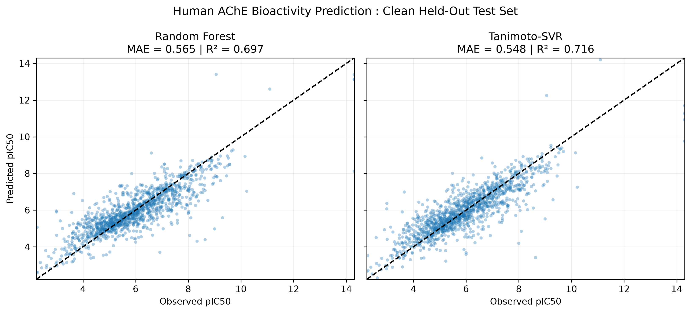
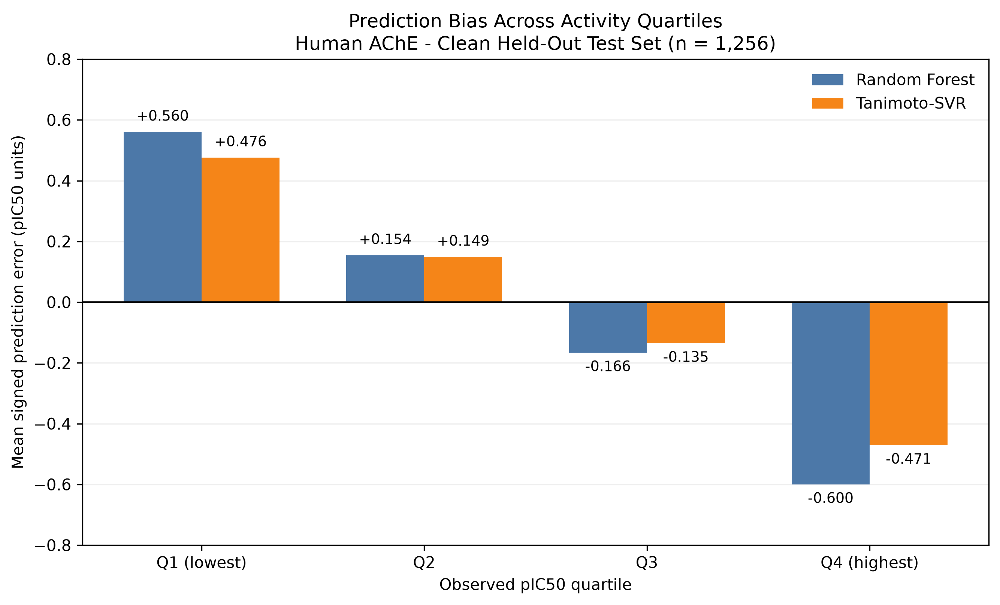
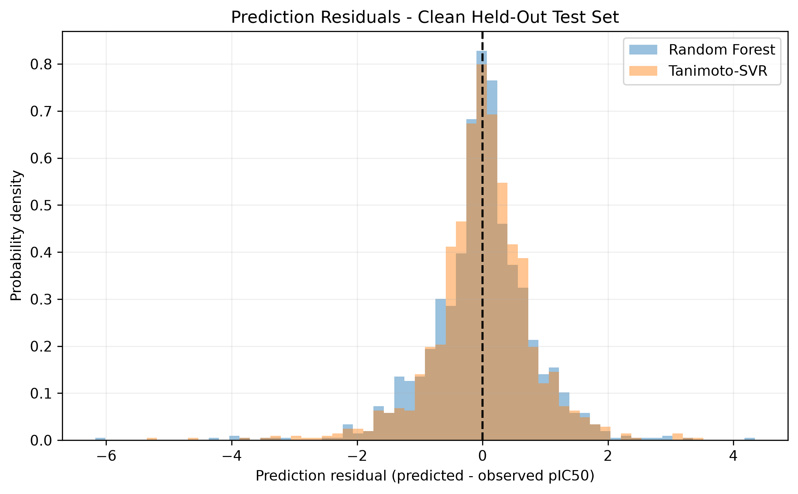
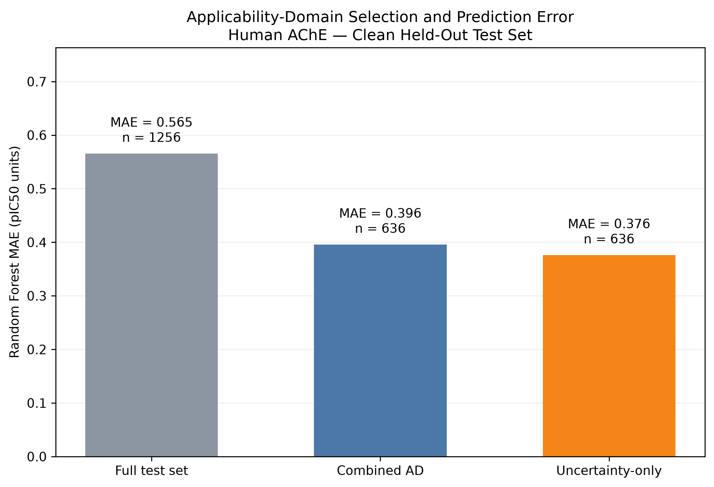
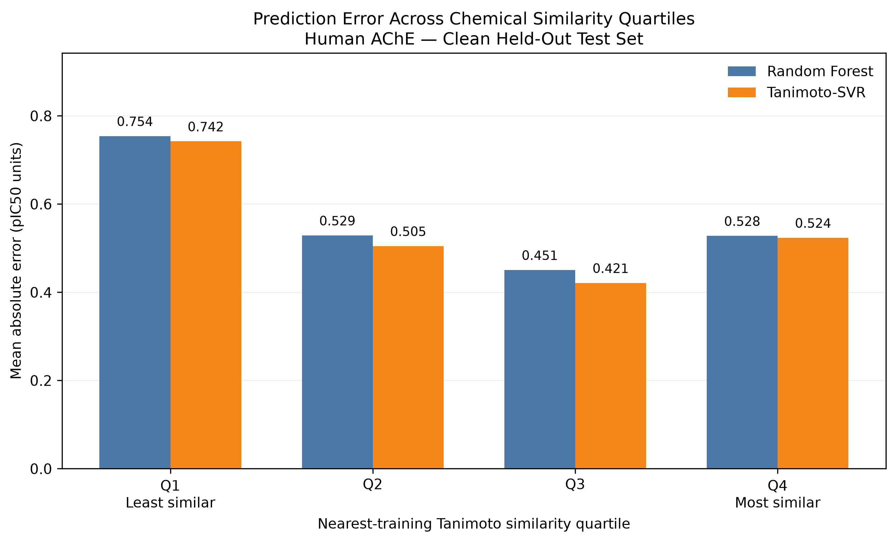
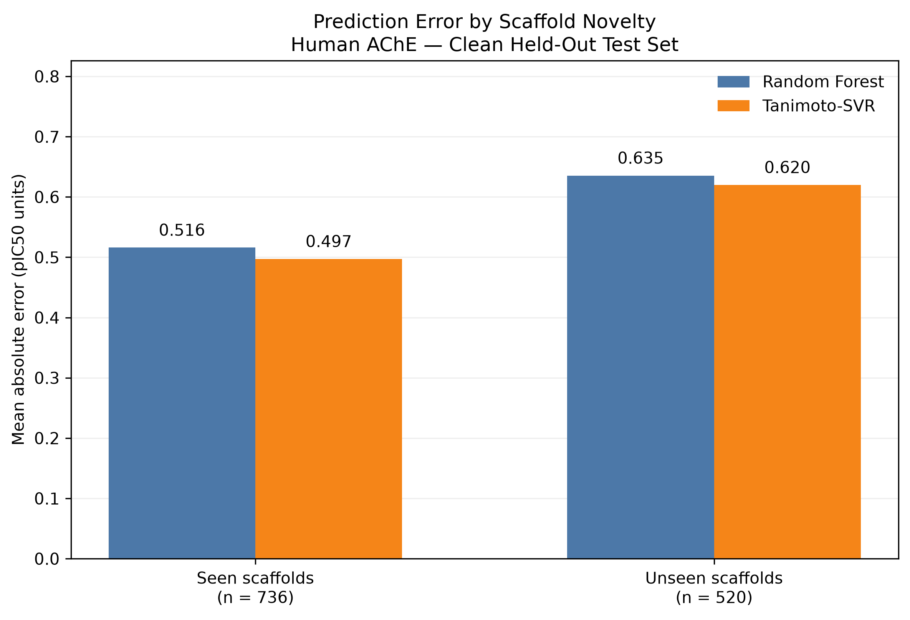
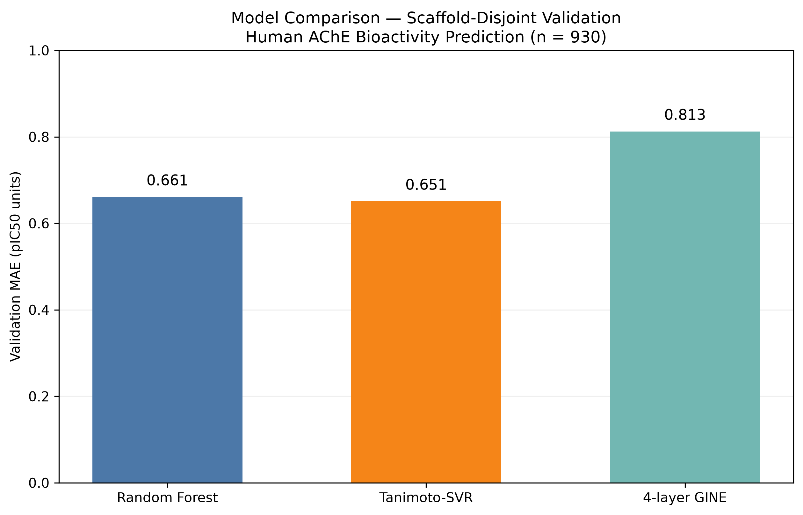

# Predicting Acetylcholinesterase Inhibitor Activity with Machine Learning

## Project Overview

Acetylcholinesterase (AChE) is an enzyme that breaks down acetylcholine, a neurotransmitter involved in communication between nerve cells. Molecules that inhibit AChE are of interest in drug discovery, particularly in research related to Alzheimer's disease.

In this project, I investigated how well different machine learning approaches can predict the inhibitory activity of molecules against human AChE using their chemical structures.

I compared three models: a Random Forest, a Support Vector Regression model using molecular similarity (Tanimoto-SVR), and a graph neural network based on the GINE architecture.

Beyond comparing prediction accuracy, I wanted to understand where the models performed well, where they struggled, and how reliably they could make predictions for molecules that differed from those used during training.

## Main Results

The Random Forest and Tanimoto-SVR models achieved similar performance on the held-out test set of 1,256 molecules. Tanimoto-SVR had a slightly lower mean absolute error (MAE), although the difference was not conclusive in our paired bootstrap analysis.

| Model | Test MAE | Test RMSE | Test R² |
|---|---:|---:|---:|
| Random Forest | 0.565 | 0.816 | 0.697 |
| Tanimoto-SVR | 0.548 | 0.789 | 0.716 |

The four-layer GINE model was evaluated on the separate validation set but was not evaluated on the held-out test set. On validation, its MAE was 0.813, compared with 0.661 for Random Forest and 0.651 for Tanimoto-SVR.

Several findings stood out:

- Both fingerprint-based models predicted the overall activity trend reasonably well, but tended to overpredict low pIC50 values and underpredict high values.
- Prediction errors were larger for molecules with scaffolds not represented in the training set.
- Molecules with low similarity to the training data were generally harder to predict, although the relationship between similarity and error was not uniform.
- A validation-defined applicability domain identified a subset of test molecules with lower prediction error, at the cost of covering only about half the test set.
- The GINE model did not outperform the simpler fingerprint-based models under the conditions tested.

These results highlight an important point in molecular machine learning: good average prediction accuracy does not necessarily mean a model will perform equally well across different regions of chemical space.


### Predicted vs. Experimental Activity



**Figure 1.** Predicted versus experimental pIC50 values for Random Forest and Tanimoto-SVR on the held-out test set of 1,256 molecules. Both models captured the overall activity trend, but predictions were less accurate at the extremes. Low experimental pIC50 values tended to be overpredicted, while high values tended to be underpredicted.


### Further Results

#### Signed Errors Across Activity Ranges



**Figure 2.** Signed prediction errors grouped by experimental pIC50 quartile. This analysis helps reveal systematic bias across activity ranges, complementing Figure 1: the fingerprint-based models tended to overpredict lower-activity compounds and underpredict higher-activity compounds. The direction of a signed error depends on the plotting convention used in the analysis.

#### Residual Distributions



**Figure 3.** Distributions of prediction residuals for the fingerprint-based models. Examining the spread and tails of the residuals complements the aggregate MAE and RMSE values and helps assess whether typical errors obscure less frequent, larger prediction errors.

#### Applicability Domain



**Figure 4.** Random Forest prediction error on the full held-out test set and on selected subsets of molecules. The validation-defined applicability domain reduced MAE from 0.565 to 0.396 while retaining 636 of 1,256 molecules. A retrospective uncertainty-only selection achieved an MAE of 0.376 at the same coverage. This comparison illustrates the trade-off between prediction accuracy and the number of molecules for which predictions are retained.

#### Molecular Similarity and Prediction Error



**Figure 5.** Relationship between molecular similarity to the training data and prediction error. Molecules with lower similarity were generally harder to predict, but similarity alone did not determine the size of an individual prediction error. This motivates evaluating reliability across chemical space rather than relying only on a single overall accuracy score.

#### Generalization to New Molecular Scaffolds



**Figure 6.** Both fingerprint-based models made larger errors for molecules with scaffolds not represented in the training set. This analysis was performed within the random held-out test set and does not represent a separate scaffold-disjoint test evaluation.

#### Comparing Molecular Representations



**Figure 7.** Comparison of Random Forest, Tanimoto-SVR, and the four-layer GINE model on the same 930-molecule validation set. The fingerprint-based models achieved lower prediction errors than the GNN under the conditions tested. The GNN was not evaluated on the held-out test set.

## Project Goal

My goal was not simply to identify the model with the lowest error. I wanted to build a reproducible workflow for molecular bioactivity prediction and examine how model performance changes with molecular similarity, scaffold novelty, and prediction uncertainty.

The project brings together chemical data preparation, molecular representations, classical machine learning, graph neural networks, and careful model evaluation.

## Dataset

I used experimental bioactivity data for human acetylcholinesterase (AChE), collected from the ChEMBL database (target: CHEMBL220).

The dataset contains 6,287 molecular records with reported IC50 measurements. IC50 describes the concentration of a compound needed to reduce enzyme activity by 50%. I converted these measurements into pIC50 values, where a higher pIC50 indicates stronger inhibitory activity.

When multiple measurements were available for the same ChEMBL molecule ID, I used the median pIC50 value.

The data were divided into training, validation, and test sets. I used 4,099 molecules for training and 930 for validation, with a separate held-out test set of 1,256 molecules after removing two exact SMILES overlaps.

The training and validation sets were separated using chirality-aware molecular scaffolds. The held-out test set came from the original random split and was not designed to be scaffold-disjoint.

This distinction matters because molecules in a random test set can share structural features with those used for training. As a result, performance on the test set may not fully reflect how well the models would predict entirely new chemical scaffolds.

## Molecular Representations and Models

I compared three approaches to representing molecules and predicting their AChE inhibitory activity.

### Random Forest

For the Random Forest model, I represented each molecule using a Morgan count fingerprint with a radius of 2 and 2,048 features.

These fingerprints describe local chemical environments within a molecule. The Random Forest then learns relationships between those structural features and measured pIC50 values.

### Tanimoto-SVR

For Support Vector Regression (SVR), I used binary Morgan fingerprints with a radius of 2 and 2,048 bits.

Instead of using the fingerprints directly, I calculated Tanimoto similarity between pairs of molecules. This allowed the model to make predictions based on patterns of molecular similarity.

### Graph Neural Network

I also trained a four-layer Graph Isomorphism Network with Edge Features (GINE).

Unlike molecular fingerprints, the GNN represents a molecule as a graph, where atoms are nodes and chemical bonds are edges. The model learns from the connections between atoms and the features associated with each atom and bond.

This provided a useful comparison between fixed molecular fingerprints and a learned graph-based representation.

## Model Evaluation

I evaluated the models using three standard regression metrics:

- **Mean absolute error (MAE):** The average size of the prediction error.
- **Root mean squared error (RMSE):** A measure of prediction error that gives more weight to larger mistakes.
- **R²:** A measure of how much variation in the experimental activity values is explained by the predictions.

I also examined prediction errors across activity ranges, molecular similarity, and scaffold novelty.

For the Random Forest, I studied whether disagreement among individual trees, together with similarity to the training molecules, could help identify predictions with lower error.

The Random Forest and Tanimoto-SVR models were evaluated on the frozen held-out test set. The GINE model was evaluated on the validation set only.

## Project Structure

The project is organized so that the data, models, code, and results can be explored separately.

```text
ache-bioactivity-ml/
├── data/          # Cleaned AChE bioactivity dataset
├── models/        # Saved Random Forest, SVR, and GINE models
├── src/           # Molecular graph features and GNN architecture
├── configs/       # Frozen data splits and evaluation settings
├── notebooks/     # Research notebooks and model development
├── results/       # Scientific figures and model metrics
├── reports/       # Research notes and figure captions
├── environment/   # Software versions and dependencies
└── README.md
```

The notebooks document the development of the project, while the saved models,
data splits, and evaluation settings preserve the final experiments.

The figures and results table summarize the main findings.

## Reproducibility

The repository includes the cleaned bioactivity dataset, frozen data splits,
saved model artifacts, and pinned software dependencies for evaluating the
classical machine-learning models.

### Environment Setup

The Random Forest and Tanimoto-SVR evaluations were reproduced in a Python 3.11
environment with scikit-learn 1.9.1. From the project directory, run:

```bash
conda create -n ache-ml python=3.11 pip -y
conda activate ache-ml
python -m pip install -r environment/ache_requirements_inference.txt
python -m pip check
```

### Verified Frozen-Model Evaluation

The saved models in `models/` were evaluated using the cleaned data in `data/`
and the frozen indices in `configs/`. Both classical models reproduced their
original metrics on the same 1,256-molecule held-out test set within a
numerical tolerance of 1e-6.

| Model | Test MAE | Test RMSE | Test R² |
|---|---:|---:|---:|
| Random Forest | 0.565433 | 0.815533 | 0.696993 |
| Tanimoto-SVR | 0.547969 | 0.788877 | 0.716477 |

For Random Forest, the evaluation reconstructed radius-2, 2,048-feature Morgan
count fingerprints from the saved SMILES. For Tanimoto-SVR, it reconstructed
radius-2, 2,048-bit Morgan binary fingerprints and the test-versus-training
Tanimoto similarity matrix using the frozen training order.

These checks reproduce evaluation using saved model artifacts, **not training
from scratch**. The held-out test set is a random split rather than a
scaffold-disjoint external benchmark. The GINE model was evaluated on the
validation set only and was not evaluated on the frozen test set.


### Run the frozen-model evaluation

After installing the inference dependencies, run the evaluation script from the repository root:

```bash
python src/evaluate_frozen_models.py
```

The script reconstructs Morgan count fingerprints for Random Forest and a Tanimoto similarity matrix from Morgan binary fingerprints for SVR. It then evaluates both frozen models on the 1,256-molecule held-out test set.

The script checks the resulting MAE, RMSE, and R² values against the reported results with a numerical tolerance of 1e-6. A successful run ends with:

```text
PASS: Both frozen models reproduced.
```


The inference requirements do not include PyTorch or PyTorch Geometric, which
are additionally required for running the GNN. A standalone command-line
evaluation script has not yet been added to this repository.

